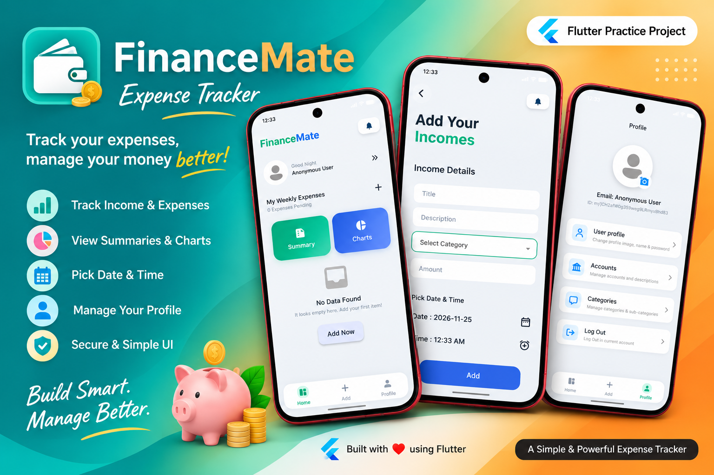

# 💰 FinanceMate – Expense Tracker

<p align="center">
  
</p>

<h3 align="center">A Personal Flutter Mobile App Development Practice Project</h3>

<p align="center">
  
  
  
</p>

---

## 📌 About This Project

**FinanceMate** is a personal expense tracker application developed using Flutter as a practice project for learning and improving my mobile application development skills.

The main purpose of this project is to gain practical experience in Flutter development, improve UI/UX design skills, understand application architecture, and explore real-world mobile app development concepts.

This is a learning-focused project, built to experiment with different Flutter features and strengthen my development knowledge.

> 🚀 This project is primarily created for practice and educational purposes, not as a commercial financial application.

## 📱 Application Screenshots

### 🏠 Home Screen
Get a quick overview of weekly expenses and access expense summaries and charts.


### 💰 Add Income Screen
Add income records with titles, descriptions, categories, amounts, and custom date and time selection.


### 👤 Profile Screen
Access profile settings, account management, categories, and logout functionality.


## ✨ Features

- 🏠 Modern home dashboard
- 💰 Add and manage income records
- 💸 Expense tracking
- 📊 Expense summaries and charts
- 📂 Category management
- 📅 Custom date and time selection
- 👤 User profile management
- 🔐 Anonymous user authentication
- 🎨 Clean and modern user interface
- ⚡ Smooth UI animations

## 🛠️ Technologies Used

| Technology | Purpose |
|---|---|
| Flutter | Mobile application development |
| Dart | Programming language |
| Firebase | Backend services (where configured) |
| Provider | State management (where configured) |
| Git & GitHub | Version control |

## 🎯 Learning Objectives

Through this project, I aim to improve my understanding of:

- Flutter widgets and UI development
- Stateful and stateless widgets
- State management
- Navigation and routing
- Form validation and user input
- Firebase integration
- CRUD operations
- Image handling
- Reusable widgets and clean code structure
- Mobile application UI/UX design

## 🚀 Getting Started

Follow these steps to run the project locally.

**1. Clone the repository**

```bash
git clone https://github.com/YOUR_USERNAME/expense-tracker-practice.git
```

**2. Navigate to the project directory**

```bash
cd expense-tracker-practice
```

**3. Install dependencies**

```bash
flutter pub get
```

**4. Run the application**

```bash
flutter run
```

Make sure Flutter and Dart are installed and configured on your machine.

## 📚 Project Type

- Project Category: Personal Practice Project
- Development Platform: Flutter
- Application Type: Mobile Application
- Main Purpose: Learning and Skill Development
- Status: Practice / Learning

## 👨‍💻 Developer

**Tharindu Nirmal**

Flutter & Software Development Enthusiast

- GitHub: [THARINDUnirmal](https://github.com/THARINDUnirmal)
- LinkedIn: [Tharindu Nirmal](https://www.linkedin.com/in/tharindu-nirmal-b15379338)

---

<p align="center">
  <b>Built with ❤️ using Flutter</b>
  <br>
  Learning by building. Improving with every project. 🚀
</p>
